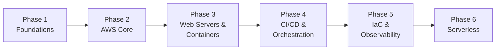

<div align="center">

# 🛤️ devops-roadmap

**My structured journey through DevOps & Cloud Engineering — documented in public.**

📚 Notes · 🧩 Guides · ⚙️ Real-world examples · 🚀 Built one topic at a time


</div>

---

## 📌 About This Repo

This repo is my personal learning log as I work through **DevOps and Cloud Engineering**, one topic at a time. Instead of letting notes rot in a notebook or a random Notion page, I'm publishing them here — partly to keep myself accountable, and partly so the notes are useful to anyone else on the same path.

Each topic gets its own folder with a clean, practical reference guide (PDF + notes), covering the concepts that actually matter on the job — not just theory, but how things are used in real-world infrastructure.

> 💡 **Why public?** Writing things down forces clarity. If I can't explain a concept simply, I don't actually understand it yet. This repo is proof-of-work for that process.

---

## 📚 Guides at a Glance

| # | Topic | Guide | Pages | Status |
|---|---|---|---|---|
| 1 | AWS IAM — Identity & Access Management | [📄 AWS_IAM_Complete_Guide.pdf](./aws-iam/AWS_IAM_Complete_Guide.pdf) | 20 | ✅ Complete |
| 2 | NGINX — Web Server, Reverse Proxy & Load Balancer | [📄 NGINX_Complete_Reference_Guide.pdf](./nginx/NGINX_Complete_Reference_Guide.pdf) | 20 | ✅ Complete |

---

## 🗺️ Roadmap

Topics are added as I learn them — roughly in the order a real DevOps/Cloud path tends to go. Checked items have a complete guide in this repo.



### Phase 1 — Foundations
- [ ] Linux Fundamentals for DevOps
- [ ] Git & GitHub Workflows

### Phase 2 — AWS Core
- [x] **AWS IAM** — Identity & Access Management *(see [`/aws-iam`](./aws-iam))*
- [ ] AWS EC2 & Networking (VPC, Subnets, Security Groups)
- [ ] AWS S3 & Storage

### Phase 3 — Web Servers & Containers
- [x] **NGINX** — Web server, reverse proxy, load balancing & TLS *(see [`/nginx`](./nginx))*
- [ ] Docker & Containerization

### Phase 4 — CI/CD & Orchestration
- [ ] CI/CD Pipelines (GitHub Actions / Jenkins)
- [ ] Kubernetes Basics — hands-on lab in progress: [kubernetes-lab](https://github.com/Prajjawalsingh87/kubernetes-lab)

### Phase 5 — Infrastructure as Code & Observability
- [ ] Terraform & Infrastructure as Code
- [ ] Monitoring & Logging (CloudWatch, Prometheus, Grafana)

### Phase 6 — Serverless
- [ ] AWS Lambda & Serverless

*(Roadmap will evolve — items may be reordered or expanded as I go deeper.)*

---

## 📂 Repo Structure

```
devops-roadmap/
├── aws-iam/
│   └── AWS_IAM_Complete_Guide.pdf
├── nginx/
│   └── NGINX_Complete_Reference_Guide.pdf
├── (future topics follow the same pattern)
└── README.md
```

Each topic folder is self-contained: a complete guide (PDF) plus any quick-reference notes, diagrams, or policy/config examples relevant to that topic.

---

## ✅ Guide: AWS IAM

The first completed guide covers **AWS Identity and Access Management** end-to-end:

| Covered | Covered |
|---|---|
| Root Account vs IAM User | Policy Types (Managed/Inline) |
| IAM Users, Groups & Roles | Policy Evaluation Logic |
| IAM Policy JSON Structure | IAM Best Practices |
| Effect, Action & Resource | Real-World Policy Examples |
| Condition Operators | Quick Reference Summary |

📄 **[Read the full AWS IAM guide →](./aws-iam/AWS_IAM_Complete_Guide.pdf)**

---

## ✅ Guide: NGINX

A deep dive into **NGINX** — architecture, configuration and production patterns (8 chapters, Ubuntu/Debian focused):

| Covered | Covered |
|---|---|
| Introduction & Event-Driven Architecture | Reverse Proxy (headers, timeouts, caching) |
| Configuration Contexts & Location Matching | Load Balancing (upstreams, algorithms, health checks) |
| Hosting Static Sites & SPAs | TLS/SSL with Certbot & Security Headers |
| Basic Authentication (htpasswd) | Advanced: WebSockets, Gzip, Rate Limiting, Logging |

📄 **[Read the full NGINX guide →](./nginx/NGINX_Complete_Reference_Guide.pdf)**

---

## 🎯 Goals

- Build a solid foundation in cloud infrastructure and DevOps practices
- Document everything in a way that's useful to revisit later
- Move from theory → hands-on labs → real projects
- Eventually deploy and manage real cloud-based projects end-to-end

---

## 🧭 How to Use This Repo

1. Pick a phase from the roadmap above — they build on each other, but each guide stands alone.
2. Open the PDF in the topic folder (GitHub renders PDFs in the browser), or clone the repo to read offline:

   ```bash
   git clone https://github.com/Prajjawalsingh87/devops-roadmap.git
   ```

3. Try the examples on a free-tier or sandbox account — never practise on a production account.

---

## 🤝 Following Along / Contributing

This is primarily a personal learning repo, but if you spot an error or have a suggestion, feel free to open an issue or PR. If this helped you while learning DevOps too, a ⭐ is appreciated — it keeps me motivated to keep documenting.

---

<div align="center">

**#DevOps · #AWS · #CloudComputing · #LearningInPublic**

*Started June 2026 — updated as I go.*

</div>
